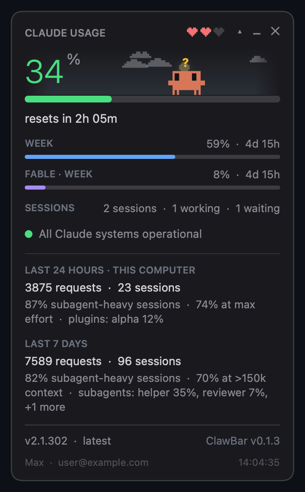

# ClawBar

Your Claude plan limits in the macOS menu bar, plus a small floating widget where Clawd, the pixel crab from Claude
Code's welcome screen, lives. ClawBar is a native Swift port of
[clawd-usage-winwidget](https://github.com/Enhed/clawd-usage-winwidget) 1.3.0 by Enhed.



- **Menu bar item:** a mini Clawd and the current session % in the level colour (green, amber from 60%, red from 85%).
- **Widget:** the session %, the time until the window resets, the week and per-model weeks (Fable, Sonnet), running
  Claude Code sessions with a hover list, Anthropic's service status, 24 h / 7 d usage details, the Claude Code
  version with a one-click update, and your plan and account.
- **Clawd** reacts to all of it: he works while a session is busy, hops and asks "?" when one waits for you, wanders
  and dozes when idle, burrows to sleep when nothing runs, sweats near the limit and lies belly-up at 100%. Three
  hearts show how much of the session limit is left. Click him for a trick.
- **The sky** behind him follows the real time of day and the live weather where you are: sun and moon in their
  real phase, stars, clouds, fog, rain, snow and thunderstorms.
- **English and German**, switchable at runtime.

The numbers come from Claude Code's own `/usage` command, run locally in a mode that never reaches the model: it
costs no tokens, and ClawBar checks that on every run.

## Install

Requires macOS 15 or later, [Claude Code](https://claude.ai/code) installed and logged in, and a Swift 6.2
toolchain (Xcode or the Command Line Tools).

```sh
scripts/build-app.sh --install
open ~/Applications/ClawBar.app
```

The script builds a release binary, assembles an ad-hoc-signed `ClawBar.app` and copies it to `~/Applications`,
quitting a running copy first. ClawBar registers itself to open at login; untick **Launch at login** in its menu
to stop that.

To update, run both commands again. `config.json` and ClawBar's other files stay where they are.

## Use

- **Left-click** the menu bar item to show or hide the widget; **right-click** (or ctrl-click) it for the menu:
  refresh, larger or smaller, always on top, launch at login, open config.json, language, quit.
- **Drag** the widget from anywhere except Clawd and the buttons. ▾ opens the details, – hides the widget, ✕ quits.
- **Click** the status line to open status.claude.com, the version line to see the changelog or to run
  `claude update` when an update is out, and the ClawBar line to open the original project.
- **Right-click Clawd or the sky** for the developer menu: force a mood, play any animation, set the hearts, pick a
  time of day or weather, or watch everything in turn.
- Only one ClawBar runs at a time: opening it again shows the widget.

## Configuration

`~/Library/Application Support/ClawBar/config.json` is created on the first change and re-read on the next
refresh (10 s by default) whenever you edit it. ClawBar writes only the keys it changes, so your edits and unknown keys survive; a
value it cannot read falls back to that key's default. While the file is not valid JSON, ClawBar runs on the defaults
and the widget's last-update stamp says *error*.

| Key | Default | Meaning |
|---|---|---|
| `language` | `en` | `en` or `de` |
| `scale` | `1.2` | widget size, 0.6–4.0 |
| `opacity` | `1.0` | 0.2–1.0 |
| `topmost` | `false` | keep the widget above other windows |
| `warnPercent`, `critPercent` | `60`, `85` | level colour thresholds, 1–100 |
| `expanded` | `false` | details open |
| `showStats`, `showStatus`, `showSessions`, `showAccount`, `showMascot`, `showSky` | `true` | blocks to show |
| `weatherLat`, `weatherLon` | unset | weather for these coordinates instead of your IP's location |
| `refreshSeconds` | `10` | UI refresh, 2–300 |
| `usageIntervalSeconds` | `60` | `/usage` probe, 30–3600 |
| `statusIntervalSeconds` | `120` | service status, 30–3600 |
| `accountIntervalSeconds` | `600` | account, 60–86400 |
| `versionIntervalSeconds` | `3600` | Claude Code version, 600–86400 |
| `weatherIntervalSeconds` | `900` | weather, 300–86400 |
| `left`, `top` | unset | widget position, saved when you move it |
| `claudePath` | unset | a `claude` executable to use first |
| `launchAtLogin` | `true` | open at login |

## What it reads and sends

- **Claude Code:** `claude -p /usage` (with safe mode and no session persistence), `claude auth status`,
  `claude --version`, and `claude update` when you click it. It reads `~/.claude/sessions/<pid>.json` to list
  sessions (never the `.key` files next to them) and `settings.json` for the update channel.
- **Your login shell:** run at start (`$SHELL -ilc`) for claude's path, `PATH` and `CLAUDE_CONFIG_DIR`, which
  a GUI app does not inherit. If it gives no answer within 5 seconds and claude is not found, ClawBar asks it again
  every usage interval, at most three more times.
- **Network:** status.claude.com (status), downloads.claude.ai (latest version), raw.githubusercontent.com (the
  changelog, only while an update is out), ipwho.is (your approximate location, unless coordinates are set),
  api.open-meteo.com (weather) and api.met.no (weather fallback).
- **Its own files** live in `~/Library/Application Support/ClawBar/`: `config.json`, `state.json`, `error.log`,
  `update.log`, `clawbar.lock` (keeps a second copy from starting) and `state-dump.txt` (written for
  `--dump-state`).

## Command line

`~/Applications/ClawBar.app/Contents/MacOS/ClawBar` takes one mode:

| Mode | Does |
|---|---|
| `--diagnose` | runs every probe once and prints what it found |
| `--snapshot <dir>` | renders every widget state in both languages at three sizes, the menu bar item and the menus |
| `--record <scenario> <gif>` | records an animated scenario: `tour`, `sleep`, `limit`, `reset`, `hearts`, `weather`, `clicks` |
| `--dump-state` | prints the running app's state |
| `--command <cmd>` | sends `toggle`, `show`, `larger`, `smaller`, `refresh`, `quit` or `lang <en\|de>` to the running app |
| `--make-icon <dir>` | writes the app icon set |
| `--version` | prints the version |

## Troubleshooting

- **No menu bar item:** a full menu bar hides items behind the notch, and on macOS 26 and later System Settings ›
  Menu Bar can switch an app's item off. The widget opens at every start, and opening ClawBar again brings it up.
- **Nothing appears at all:** ClawBar exits when it cannot lock `clawbar.lock`, and says why on stderr, in
  `error.log` when it can write there, and in the unified log:
  `log show --last 1h --predicate 'subsystem == "dev.vr1e.clawbar"'`.
- **No numbers:** the widget says why. `ClawBar --diagnose` runs every probe once and prints what it found, and
  `error.log` gets a line whenever a probe starts failing.
- **A crash:** macOS keeps the report in Console under Crash Reports.

## Differences from the original

Not ported: Clawd's panel (chat, reminders, lists, recurring tasks), the PC tips, Clawd's Remote Control session,
and running as administrator (`runAsAdmin`). German replaces Russian as the second language.

- A menu bar item replaces the tray icon; the default size is 1.2, which suits Retina points.
- The menu bar item's tooltip lists every limit, each model's week included, where the tray's stops at 63
  characters. Stale numbers turn the item grey, and its tooltip says when they are from.
- The usage probe runs Claude Code in safe mode with JSON output, stops for good (until the next Claude Code
  version) if it ever reaches the model or a flag is rejected, and says so on the widget.
- `/usage` parsing also reads the reset stamps Claude Code 2.1.302 prints (with *at*, a year, or a time only),
  honours the time zone in brackets, gives every model's week its own row, and reads singular headers and
  comma-grouped counts.
- Every probe has a timeout. `claude update` runs in the background for up to 15 minutes and reports a failure with
  its output, plus how to update a Homebrew or npm install. A clean exit that leaves the old version counts as a
  failure, and a failure clears once Claude Code has updated anyway or a newer release is out.
- The widget shows why numbers are missing: Claude Code not found (with the install command), a login without a
  Claude subscription, or a stopped probe.
- Sessions refresh every 2 seconds. A `claude -p` run counts only once it is 20 seconds old, so another tool's
  `/usage` check does not show up as a session or wake Clawd.
- A session in the `shell` state counts as working, spare sessions and the daemon are not counted, and the hover
  list shows folders relative to `~`. A `procStart` number that is no Windows time from 1990–2100 keeps its session
  instead of dropping it.
- The ClawBar line and the menu header carry ClawBar's own version. Hovering the line names the original release it
  ports and clicking it opens the original project, where the original shows and opens its changelog.
- The sky uses the weather location's time zone, retries Open-Meteo hourly after falling back to met.no, and draws
  polar days and nights as day and night.
- The widget stays on all Spaces, pauses its animation while hidden or covered, and moves back on screen if its
  saved position lies on a display that is gone.
- Clawd's walk target stays inside his play area, and the bars span exactly the widget's width.

## Development

```sh
swift build
swift test
.build/debug/ClawBar --snapshot /tmp/clawbar-snap
```

The package has one target per concern: `ClawBarShared` (every type the others share, and the English and German
string tables), `ClawBarData` (probes, sessions, config, weather), `ClawBarPresenter` (every display rule),
`ClawBarClawd`, `ClawBarSky` and the `ClawBar` app. `AGENTS.md` lists the toolchain quirks and rules.

`CLAWBAR_HOME=<dir>` runs ClawBar on that folder instead of Application Support, so a build can run next to the
installed app. Each folder has its own single copy, `--command` and `--dump-state` reach the copy on the same
`CLAWBAR_HOME`, and only the installed app on the default folder manages the login item.

## License

MIT. ClawBar includes the original's copyright notice (© 2026 Venger Sergey); see [LICENSE](LICENSE).

---

Not affiliated with Anthropic. Clawd and Claude are Anthropic's.
